<div align="center">


# InvoiceMesh

**Internationale Rechnungen einlesen, normalisieren, prüfen – und als XRechnung ausgeben.**

XRechnung, ZUGFeRD/Factur-X, Peppol, UBL, CII, PDFs und Scans: InvoiceMesh erkennt das Format am Inhalt, liest die Daten aus,
überführt sie in **dein eigenes Datenmodell**, prüft sie nach EN 16931 und erzeugt standardkonforme Ausgaben.
Ein Container plus PostgreSQL, auf dem eigenen Server.

</div>

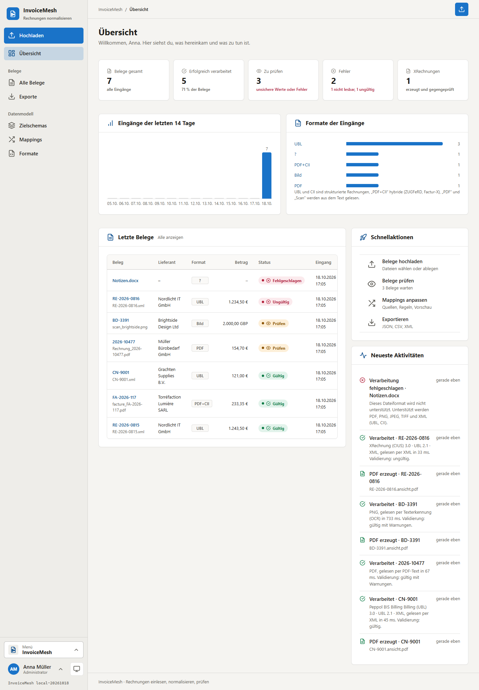

---

## Worum es geht

Rechnungen kommen in jeder Form: als XRechnung an eine Behörde, als ZUGFeRD-PDF vom Lieferanten, als Peppol-Gutschrift aus den
Niederlanden, als PDF aus einer Textverarbeitung oder als Foto vom Handy. InvoiceMesh macht daraus **eine** Sicht – in einem Schema,
das du selbst bestimmst – und sagt dir bei jedem Wert, woher er kommt, wie sicher er ist und ob die Rechnung stimmt.
Fehlende Angaben werden nie erfunden: was nicht auf dem Beleg steht, wird als fehlend gemeldet und kann von einer Person ergänzt werden.

## Auf einen Blick

**Einlesen**
- **Erkennung am Inhalt**, nie an der Endung: Dateityp, **Syntax** (UBL 2.x, CII D16B), **Standard**, **Profil** und **Version** getrennt – mit Begründung
- **XRechnung** (UBL und CII, 1.2 bis 3.0 inkl. Extension), **Peppol BIS Billing 3.0**, **ZUGFeRD / Factur-X** (Minimum bis Extended, ZUGFeRD 1.0 als Rohdaten), **EN 16931**, NLCIUS
- **Hybride PDFs:** das eingebettete XML wird bevorzugt gelesen; PDF und XML bleiben beide unverändert erhalten
- **PDFs ohne Daten** über ihre Textebene, **Scans, PNG, JPEG, TIFF** per **Texterkennung** (Tesseract, Deutsch, Englisch, Französisch, Spanisch, Italienisch, Niederländisch)
- Mehrsprachige Heuristik für Text: Nummer, Datum, Parteien, USt-IdNr., IBAN (mit Prüfziffer), Summen, Steuern, Positionen – jeder Wert mit **Quelle und Konfidenz**
- **Weitere Formate ohne Programmänderung:** eigene Spezifikationskennungen unter *Einstellungen › Formate*

**Normalisieren**
- **Frei konfigurierbares Zielschema:** Gruppen und Felder anlegen, umbenennen, sortieren, entfernen; Datentypen, Pflichtfelder, Standardwerte, erlaubte Werte
- **Verschachtelt:** wiederholte Gruppen für Positionen, Steuern, Nachlässe
- **Mappings** pro Format, Standard, Profil oder Version: mehrere Quellen mit **Priorität**, **Zusammenführen** und **Aufteilen**, **Transformationen**
  (Datum, Zahl, Ersetzen, Übersetzen …), **Bedingungen**, **Standardwerte** – alles in der Oberfläche, ohne Code
- Quellen sind die Geschäftsbegriffe von EN 16931 (`bt:BT-1`), **XML-Pfade** (`xml:/Invoice/cbc:ID`), **Textzeilen** aus PDF/OCR (`text:Rechnungsnummer`) und Metadaten
- **Konflikte, fehlende Werte und nicht zugeordnete Quellfelder** werden angezeigt
- **Entwürfe, Vorschau, Probelauf, Versionen:** jede Änderung entsteht als Entwurf, wird an Beispielbelegen getestet und erst dann aktiviert;
  jede Normalisierung bleibt mit Schema- und Mapping-Version nachvollziehbar

**Prüfen und ausgeben**
- **Validierung** nach EN 16931 (Pflichtangaben, Summen BR-CO-10…16, Steuern, Codelisten), **XRechnung** (BR-DE) und **Peppol BIS**, dazu Plausibilität und das Zielschema
- **Verarbeitung und Validierung getrennt:** ein Beleg kann fehlerfrei verarbeitet und trotzdem ungültig sein
- **XRechnung 3.0** in UBL oder CII aus vollständigen Daten – unabhängig vom eigenen Schema, nach dem Schreiben gegengeprüft;
  in der CI zusätzlich mit dem **offiziellen Validator der KoSIT** geprüft
- **Lesbare PDF-Ansicht**, wenn es kein Original-PDF gibt; **Validierungsbericht** als PDF und JSON
- **Exporte** als **JSON, CSV oder XML**, konfigurierbar: Gruppen, Felder, eine Zeile je Beleg oder je Position, Trennzeichen, Elementnamen
- **Manuelle Korrektur** der ausgelesenen Daten oder einzelner Zielfelder – mit Person, Zeit, Begründung und Rücknahme; das Original wird nie verändert

**Betrieb**
- Lokale Anmeldung mit **TOTP**, Rollen **Administrator**, **Benutzer** und **Anonym** (Freigabelink mit Ablauf und optionalem Passwort)
- Sitzungen überstehen einen Neustart des Containers
- **Backup** nach Zeitplan direkt auf ein **NAS** (SMB) oder in einen Ordner, mit **Retention**, optional verschlüsselt; Wiederherstellung mit Sicherheitskopie
- Für das Handy gemacht, hell und dunkel, installierbar (PWA)

## Screenshots

### Belege und ihre Verarbeitung

| Alle Belege | Ein Beleg |
|---|---|
| 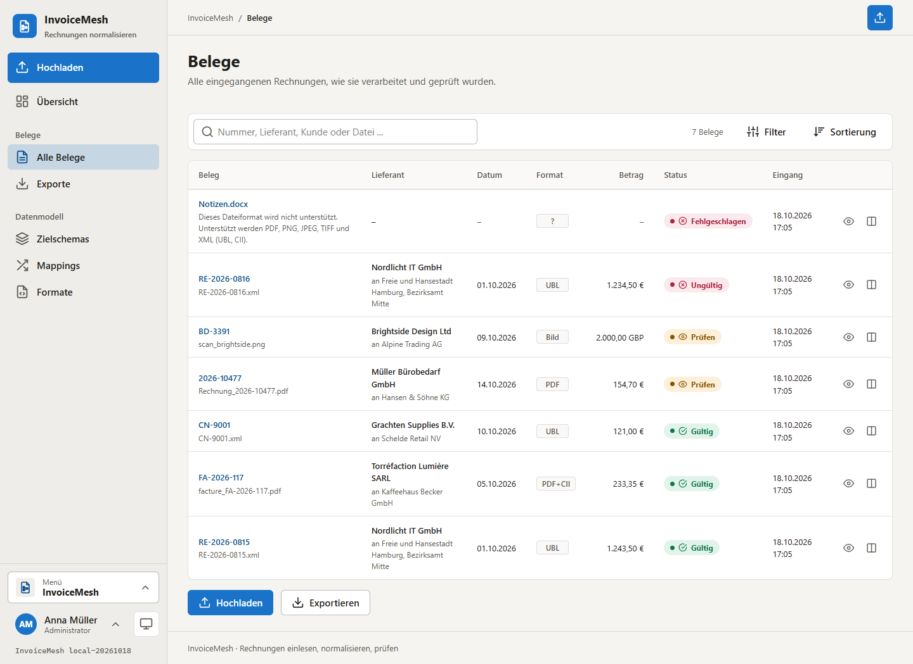 | 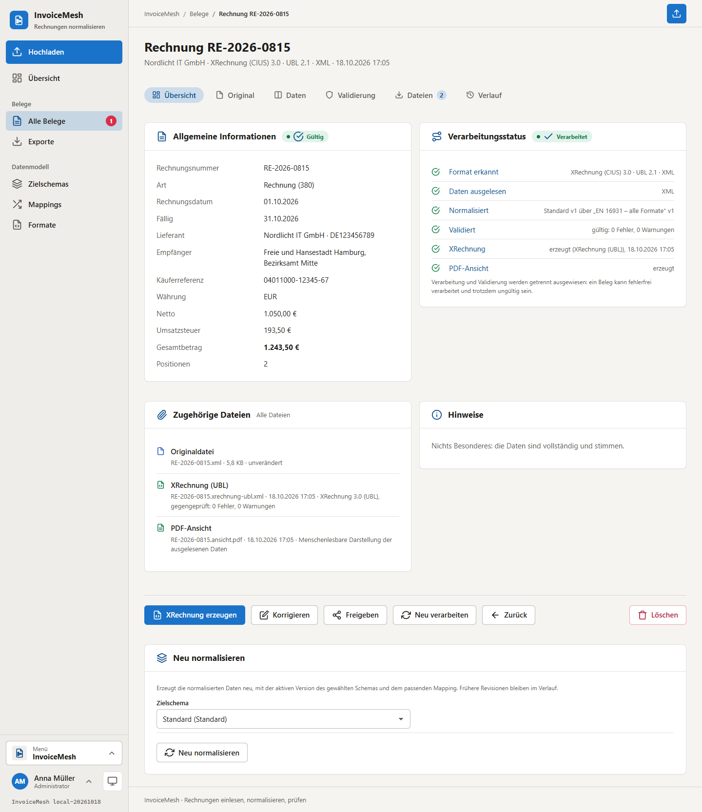 |

Jeder Beleg zeigt seine Schritte – Format erkannt, ausgelesen, normalisiert, validiert, XRechnung, PDF – und was es zu tun gibt.

### Original, Hybrid und Scan

| ZUGFeRD/Factur-X: PDF mit eingebettetem XML | Scan, gelesen per Texterkennung |
|---|---|
| 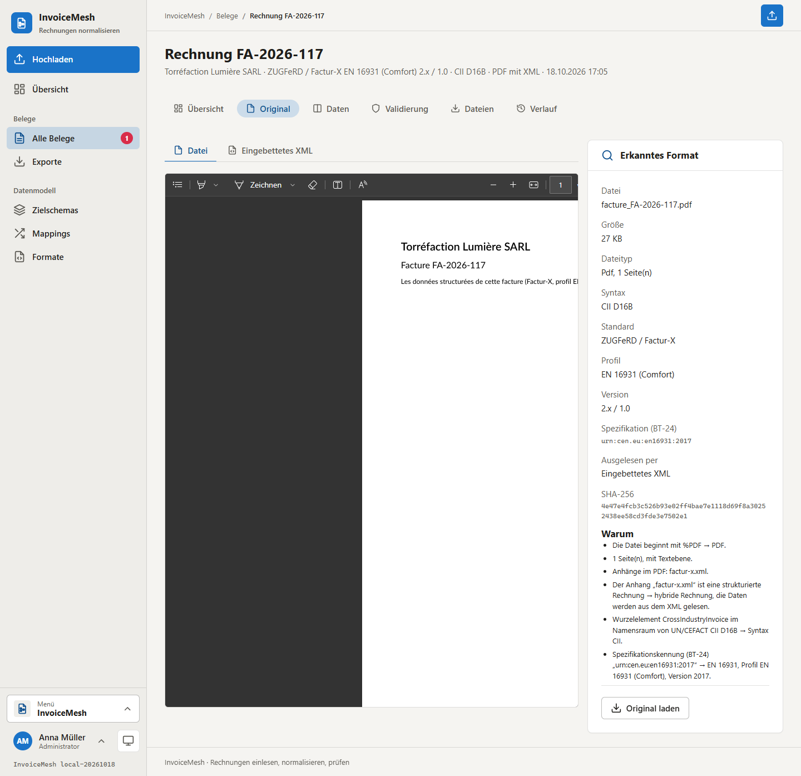 | 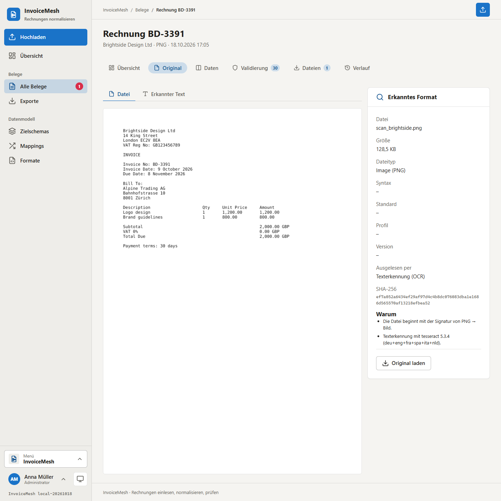 |

### Vergleich und Validierung

| Quellen ↔ normalisierte Daten | Validierungsbericht |
|---|---|
| 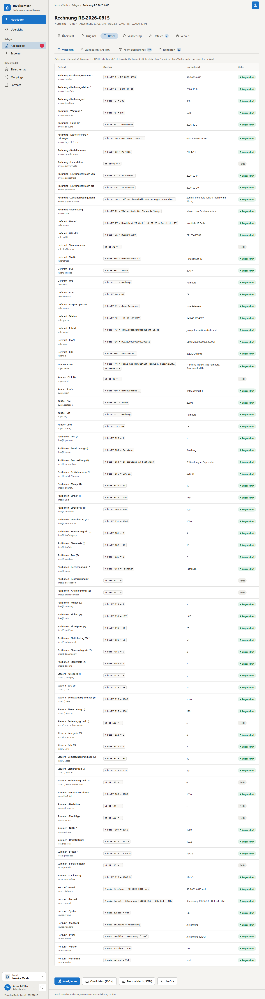 | 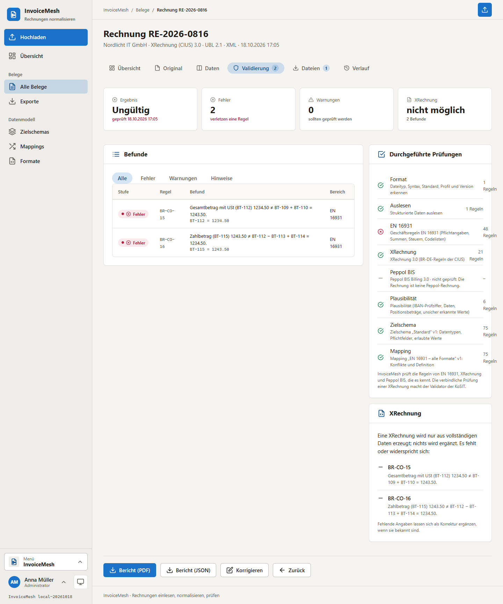 |

### Datenmodell und Mapping

| Zielschema | Regel eines Mappings | Vorschau vor dem Aktivieren |
|---|---|---|
| 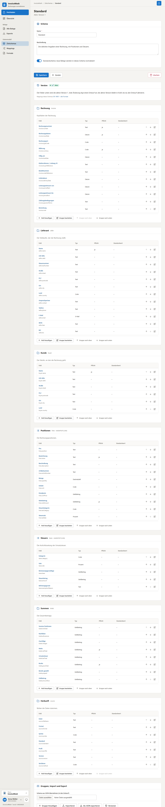 | 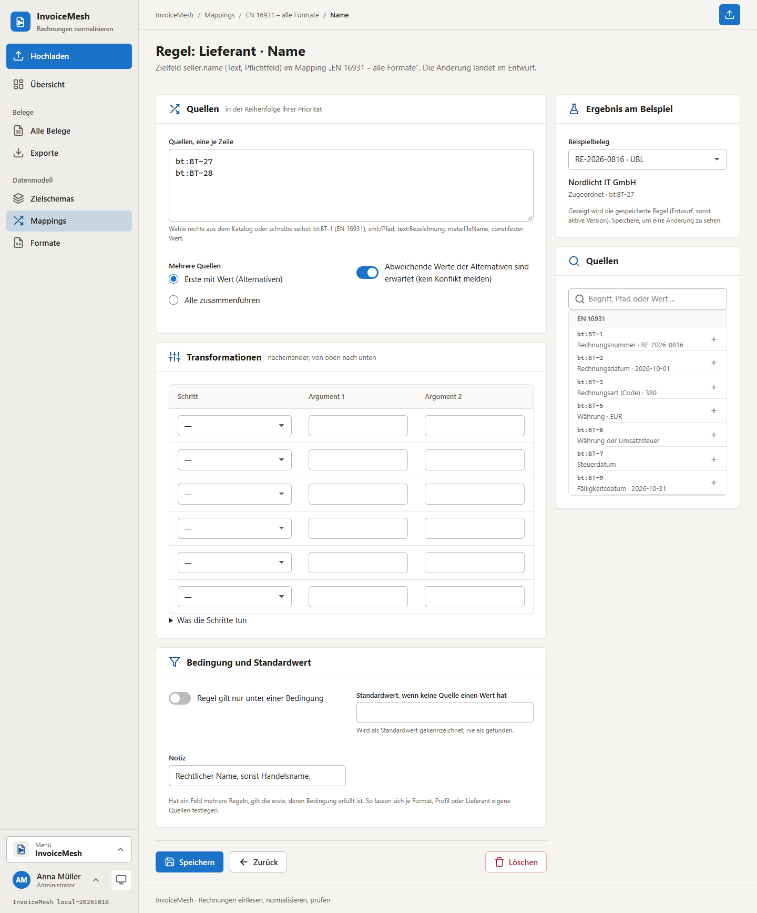 | 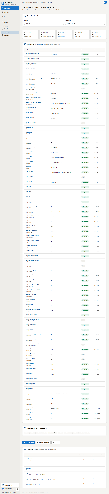 |

### Exporte und Handy

| Export | Übersicht auf dem Handy | Beleg auf dem Handy |
|---|---|---|
| 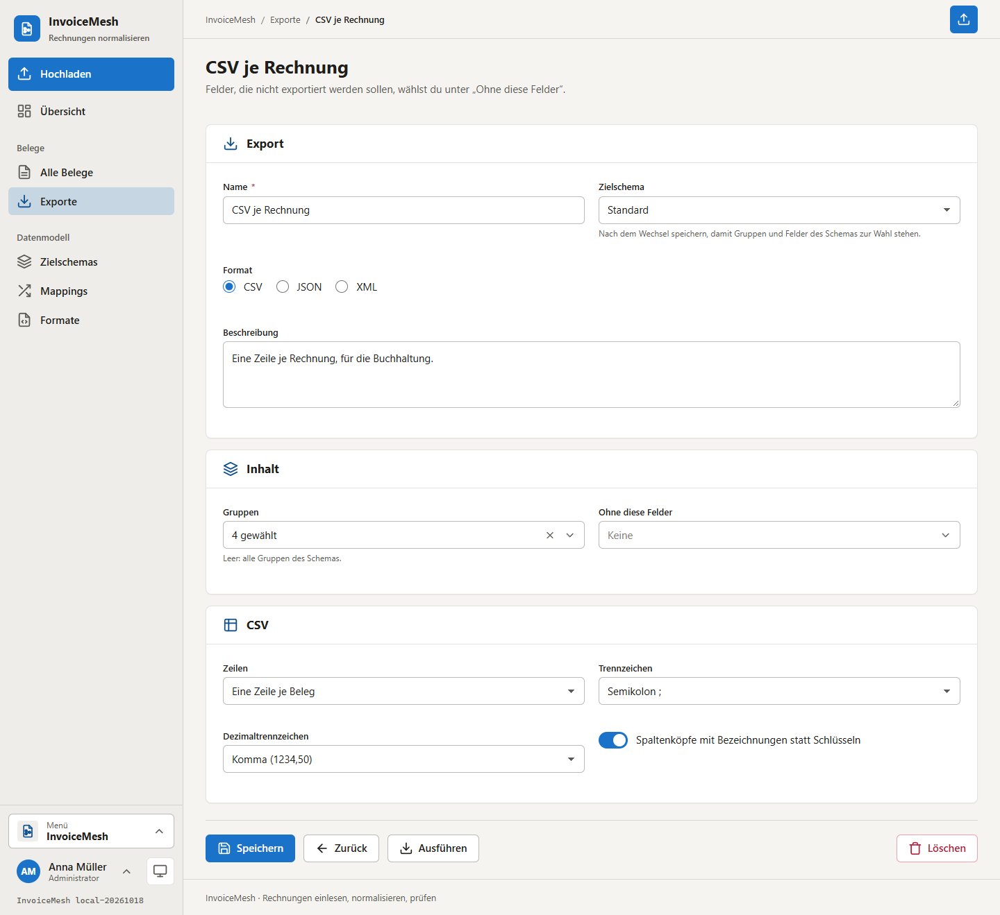 | 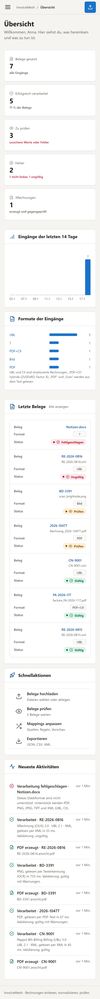 | 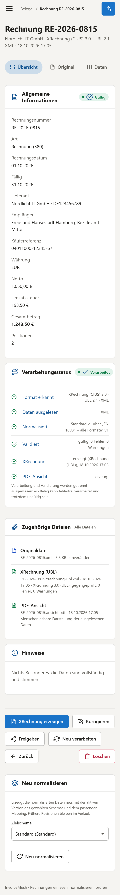 |

## Installation

### 1. Docker Compose

```yaml
name: invoicemesh

services:
  invoicemesh:
    image: ghcr.io/real-ttx/invoicemesh:latest   # :nightly für den Stand von dev
    restart: unless-stopped
    depends_on:
      db:
        condition: service_healthy
    ports:
      - "2308:2308"
    environment:
      TZ: Europe/Berlin
      INVOICEMESH__Database__Password: ${INVOICEMESH_DB_PASSWORD:-invoicemesh}
    volumes:
      - invoicemesh-data:/data

  db:
    image: postgres:17
    restart: unless-stopped
    environment:
      POSTGRES_PASSWORD: ${INVOICEMESH_DB_PASSWORD:-invoicemesh}
      POSTGRES_DB: invoicemesh
    healthcheck:
      test: ["CMD-SHELL", "pg_isready -U postgres -d invoicemesh"]
      interval: 5s
      timeout: 5s
      retries: 20
    volumes:
      - invoicemesh-db:/var/lib/postgresql/data

volumes:
  invoicemesh-data:
  invoicemesh-db:
```

```bash
echo "INVOICEMESH_DB_PASSWORD=$(openssl rand -hex 24)" > .env   # eigenes Datenbank-Passwort, vor dem ersten Start
docker compose up -d
```

**http://localhost:2308** öffnen: Der erste Besuch legt den **Administrator** an (es gibt kein Standard-Passwort). Zum Ausprobieren legt
*Einstellungen › System › Beispieldaten anlegen* sieben Belege in verschiedenen Formaten an – eine XRechnung, ein Factur-X-PDF, eine Peppol-Gutschrift,
ein Text-PDF, einen Scan, eine fehlerhafte XRechnung und eine Datei, die keine Rechnung ist – und verarbeitet sie wie einen Upload.

Health-Check: `/health`. Ein Update ist `docker compose pull && docker compose up -d`; die Migrationen laufen beim Start.

### 2. Hinter einem Reverse Proxy, mit Backup aufs NAS

InvoiceMesh spricht HTTP auf Port 2308. Für den Betrieb gehört ein Reverse Proxy mit TLS davor. Dann zwei Variablen setzen – die öffentliche
Adresse steht in den Freigabelinks:

```yaml
    environment:
      TZ: Europe/Berlin
      INVOICEMESH__Database__Password: ${INVOICEMESH_DB_PASSWORD:-invoicemesh}
      INVOICEMESH__Server__PublicUrl: https://rechnungen.example.de
      INVOICEMESH__Server__ForceSecureCookie: "true"
```

Backups laufen aus der App: *Einstellungen › Backup* – ein **Ziel** (Ordner oder SMB-Freigabe des NAS mit Verbindungstest), ein **Plan**
(stündlich bis monatlich, „nur System“ oder „System und Dateien“, optional verschlüsselt) und die **Aufbewahrung** (letzte N, täglich, wöchentlich, monatlich).

### 3. Aus dem Quellcode

```bash
docker compose -f docker-compose.dev.yml up -d --build    # Entwicklungs-Stack: Web 2308, pgAdmin 2318, Postgres 12308
```

### Das Volume `/data`

```
/data
├─ config/    app.json – Einstellungen (Verarbeitung, eigene Formate, Speicher, Sicherheit, Backup)
├─ keys/      Schlüssel für Cookies und gespeicherte Passwörter (Sitzungen überstehen Neustarts)
├─ files/     Originale (unverändert) und erzeugte Dateien (leer, wenn sie auf dem NAS liegen)
├─ backups/   lokale Backup-Ziele und Sicherheitskopien vor einer Wiederherstellung
└─ tmp/       Zwischenablage für Backups
```

Die Daten selbst – Belege, Auslesungen, Korrekturen, Revisionen, versionierte Schemas und Mappings – stehen in der PostgreSQL.
Mehr zum Betrieb (Variablen, Verarbeitung, KoSIT-Prüfung von Hand): [docs/OPERATIONS.md](docs/OPERATIONS.md) (englisch).

## Wie es funktioniert

```
Datei ──► Erkennen ──► Auslesen ──────────────► Korrekturen ──► Mapping ──────► Zielschema (JSON/CSV/XML)
          Typ, Syntax,  XML: Rohfelder + EN 16931  (darübergelegt,  Version n      Version m
          Standard,     PDF: Textebene            nie überschrieben)
          Profil,       Scan/Bild: OCR                    │
          Version                                         ├──► Validierung (EN 16931, XRechnung, Peppol, Schema)
                                                          └──► XRechnung (UBL/CII), PDF-Ansicht, Bericht
```

Das Herz ist das **semantische Modell von EN 16931** (die Geschäftsbegriffe BT-1 … BT-159): jeder Leser schreibt es, die Regeln prüfen es,
die XRechnung wird daraus geschrieben. Dein Zielschema ist davon getrennt und wird über Mappings gefüllt – deshalb garantiert ein eigenes Schema
nie die XRechnung-Konformität, und die XRechnung hängt nie an deinem Schema.

## Entwicklung

Getestet wird über den Container – nach jeder Änderung neu bauen und den Stack neu deployen:

```powershell
./scripts/redeploy.ps1            # Image neu bauen, Dev-Stack neu deployen
./scripts/redeploy.ps1 -Fresh     # dasselbe mit leeren Volumes
```

Tests:

```powershell
dotnet build InvoiceMesh.slnx
$env:INVOICEMESH_TEST_DB="Host=localhost;Port=12308;Username=postgres;Password=invoicemesh"; dotnet test InvoiceMesh.slnx
cd tests/e2e; npm install; node flow.js http://localhost:2308    # Browser-Durchlauf mit Edge, SHOTS=<Ordner> für Screenshots, MOBILE=1
```

Die Unit-Tests brauchen nichts (Leser, Text-Extraktion, Mapping, Transformationen, Regeln, XRechnung-Roundtrip, Exporte), die Integrationstests
die PostgreSQL des Dev-Stacks, die NAS-Tests einen Samba-Server (`INVOICEMESH_TEST_SMB`, die CI startet einen).

## Wie es gebaut ist

- **ASP.NET Core 10 Razor Pages**, **EF Core 10** auf **PostgreSQL 17** (Definitionen und Ergebnisse als `jsonb`)
- Oberfläche aus **MatUi** (MatDesign), schlichtes JavaScript ohne Framework und ohne Build-Schritt, strikte CSP ohne Inline-Skripte
- Eigene Leser und Schreiber für UBL und CII, **PdfPig** für PDFs, **Tesseract** und **Poppler** für Scans, **QuestPDF** für PDFs
  (Community-Lizenz: frei unter 1 Mio. USD Jahresumsatz), **SMBLibrary** für das NAS
- Geprüft mit dem **KoSIT-Validator** (XRechnung 3.0.2) in der CI

## Branches und Versionen

| Branch | Zweck | Version |
|---|---|---|
| `main` | Release | `<major>.<minor>.<build>-<yyyyMMdd>` |
| `dev` | Entwicklung | `nightly-<build>-<yyyyMMdd>` |
| lokal | – | `local-<yyyyMMdd>` |

`Major`/`Minor` stehen in [`Directory.Build.props`](Directory.Build.props), die Build-Nummer kommt aus der GitHub Action
(`github.run_number`). Die Action baut, testet (mit PostgreSQL, Samba und dem KoSIT-Validator) und veröffentlicht das Image unter `ghcr.io/real-ttx/invoicemesh`.
