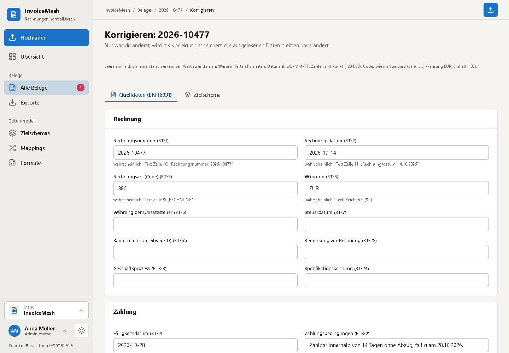
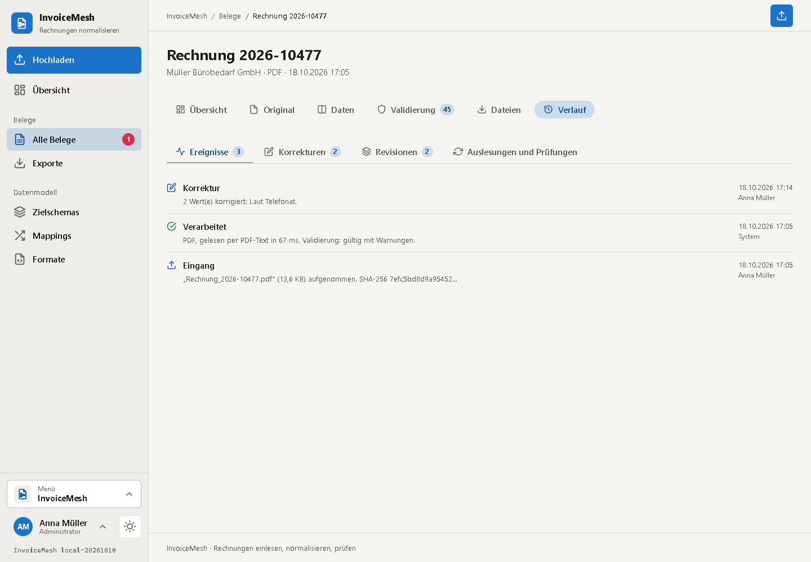
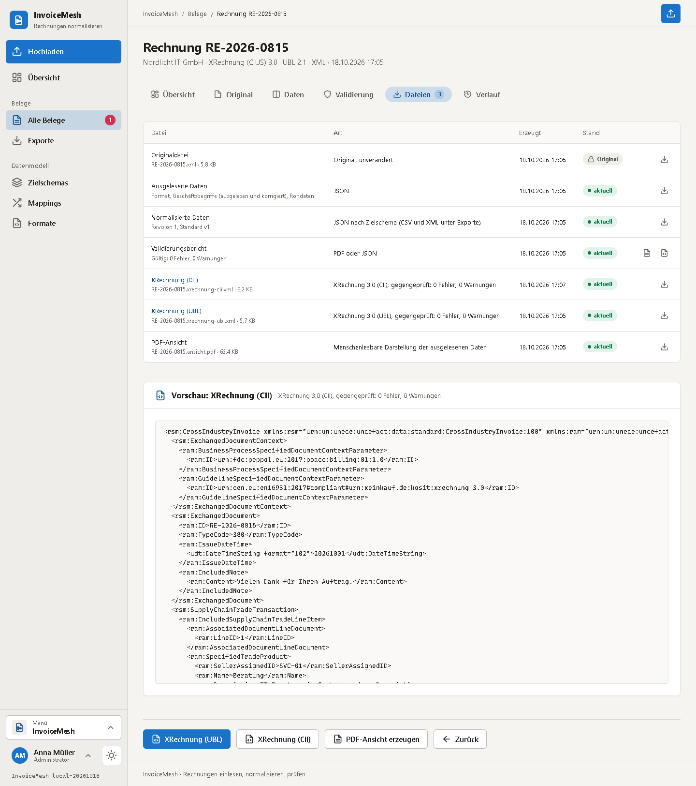
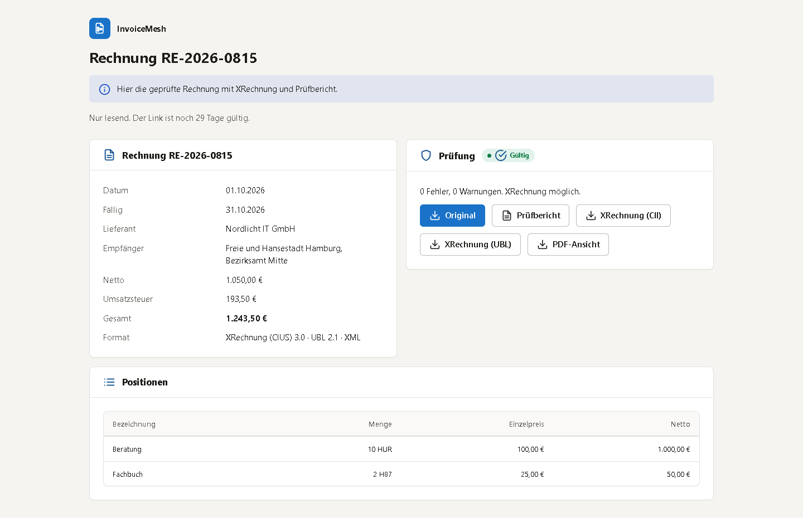
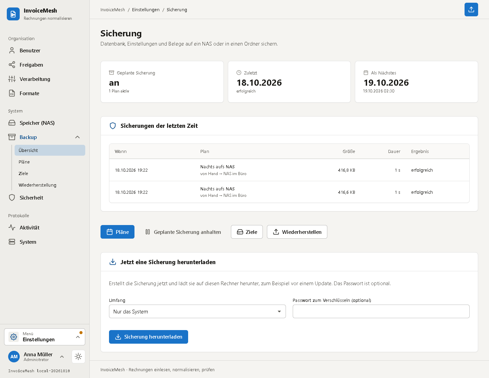
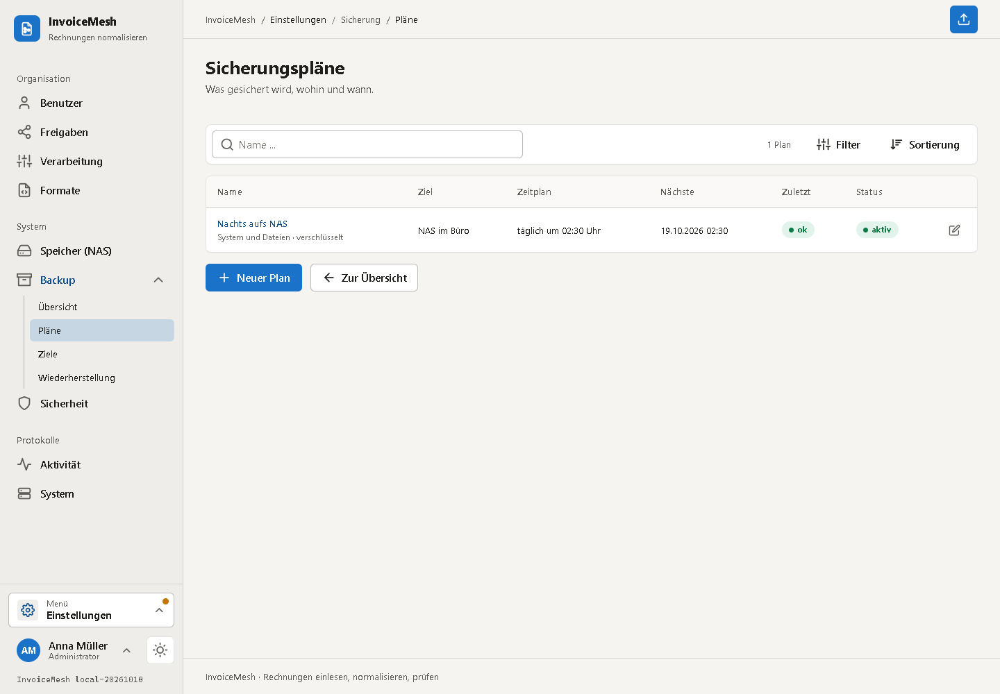
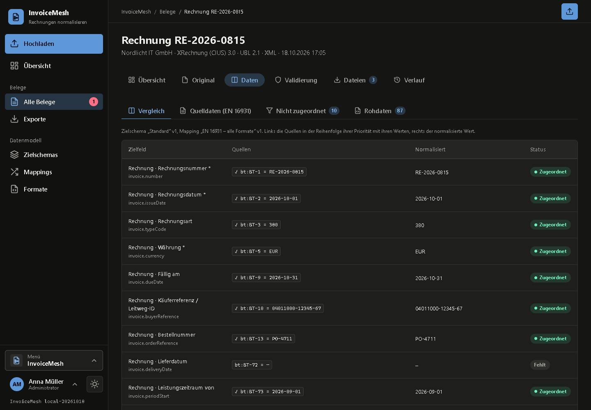
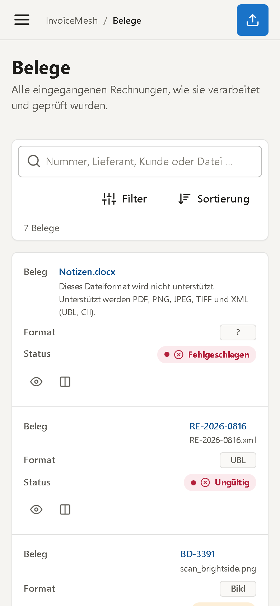
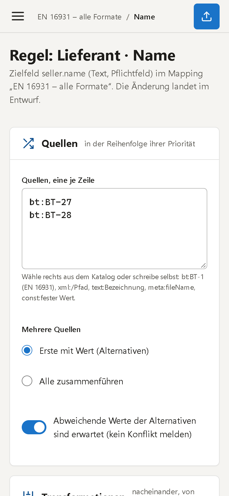

<div align="center">


# InvoiceMesh

**International invoices in, one clean data model out – checked, traceable, and as XRechnung.**

XRechnung, ZUGFeRD/Factur-X, Peppol, UBL, CII, plain PDFs and scans. Recognised by their content, read, mapped
into a schema you define, validated against EN 16931. One container plus PostgreSQL, on your own server.

</div>


---

## What this is about

Invoices arrive in every shape. A public authority wants an XRechnung, a supplier sends a ZUGFeRD PDF, a Dutch
partner sends a Peppol credit note, someone exports a PDF from a word processor, and the field team photographs a
receipt. InvoiceMesh turns all of them into **one** view, in a schema **you** decide on. For every value it tells you
where it came from, how sure it is, and whether the invoice adds up.

It never invents data. Anything that is not on the document is reported as missing, and a person can fill it in.
That correction is stored next to the original, which is never touched.

## At a glance

**Reading**
- **Detection by content, never by file extension.** File type, **syntax** (UBL 2.x, CII D16B), **standard**,
  **profile** and **version** are told apart, and each one comes with the reason it was chosen.
- **Supported formats:**
  - **XRechnung**: UBL and CII, 1.2 to 3.0, including the extension.
  - **Peppol BIS Billing 3.0**.
  - **ZUGFeRD / Factur-X**: Minimum to Extended. ZUGFeRD 1.0 is kept as raw data.
  - **EN 16931**, NLCIUS.
- **Hybrid PDFs:** the embedded XML wins. The PDF and the XML are both kept exactly as they arrived.
- **PDFs without data** are read from their text layer.
- **Scans, PNG, JPEG, TIFF** go through **OCR** (Tesseract: German, English, French, Spanish, Italian, Dutch).
- **Multilingual text heuristics** find the number, dates, parties, VAT IDs, the IBAN (check digits verified),
  totals, taxes and line items. Every value carries its **source and confidence**.
- **New formats without new code:** register your own specification identifiers under *Einstellungen › Formate*.

**Normalising**
- **Your own target schema:**
  - Groups and fields with types, required flags, defaults and allowed values.
  - **Nested, repeating groups** for line items, taxes and allowances.
- **Mappings without code:**
  - One mapping per format, standard, profile or version.
  - Several sources per field, ordered by **priority**. Values can be **merged** and **split**.
  - **Transforms** (date, number, replace, translate …), **conditions** and **defaults**.
- **Sources you can map from:**
  - EN 16931 business terms (`bt:BT-1`).
  - **XML paths** (`xml:/Invoice/cbc:ID`).
  - **Text lines** from PDF or OCR (`text:Invoice number`).
  - Metadata.
- **Conflicts, missing values and unmapped source fields** are shown, never hidden.
- **Draft → preview → test run → active:**
  - Schema and mapping changes start as drafts and can be tried on sample invoices.
  - Only then are they activated.
  - Every result records which schema and mapping version produced it.

**Checking and output**
- **Validation:**
  - **EN 16931**: mandatory fields, totals BR-CO-10…16, taxes, code lists.
  - **XRechnung** (BR-DE) and **Peppol BIS**.
  - Plausibility checks and your own schema's rules.
- **Processing and validation are kept apart.** An invoice can be processed without a hitch and still be invalid.
- **XRechnung 3.0 (UBL or CII):**
  - Written from complete data and independent of your schema.
  - Read back after writing to confirm it.
  - Checked in CI with the **official KoSIT validator**.
- **Other output:**
  - A **readable PDF** when there is no original PDF.
  - The **validation report** as PDF and JSON.
- **Exports** as **JSON, CSV or XML**, configurable: groups, fields, one row per invoice or per line, separators,
  element names.
- **Manual corrections:**
  - Either the extracted data or single target fields can be corrected.
  - Each correction records who, when and why, and can be undone.

**Running it**
- **Sign-in and roles:**
  - Local sign-in with **TOTP**.
  - Roles **Administrator** and **User**.
  - **Anonymous** access through share links, with an expiry date and an optional password.
- Sessions survive a container restart.
- **Backups:**
  - On a **schedule**, straight to a **NAS** (SMB) or into a folder.
  - With **retention** (last N, daily, weekly, monthly), optionally encrypted.
  - Restoring makes a safety copy first.
- Made for phones too, light and dark, installable as a PWA.

The interface is in German.

## Screenshots

### Invoices and what happened to them

| All invoices | One invoice |
|---|---|
|  |  |

Every invoice shows its steps: format detected, read, normalised, validated, XRechnung, PDF. It also shows what is
left to do.

### Original, hybrid and scan

| ZUGFeRD/Factur-X: a PDF with embedded XML | A scan, read by OCR |
|---|---|
|  |  |

The sidebar explains the detection: which syntax, which specification identifier (BT-24), which profile, and the
evidence behind each.

### Sources next to the result, and the validation report

| Sources ↔ normalised data | Validation report |
|---|---|
|  |  |

### Corrections and history

| Correcting extracted data | Events, corrections, revisions |
|---|---|
|  |  |

A correction only stores what you changed. Next to each field you see where the extracted value came from and how
sure the reader was. Every change produces a new revision, and older ones stay readable.

### Data model and mappings

| Target schema | A mapping rule | Preview before activating |
|---|---|---|
|  |  |  |

### Generated files, exports and share links

| Files of an invoice | An export | A share link, opened without an account |
|---|---|---|
|  |  |  |

### Backups to the NAS

| Overview | Plans |
|---|---|
|  |  |

### Dark theme and phones

| Dark | Phone: invoices | Phone: one invoice | Phone: a mapping rule |
|---|---|---|---|
|  |  |  |  |

## Quick start

Ready-made images are published to the GitHub Container Registry:

| Tag | Built from | Use it for |
|---|---|---|
| `ghcr.io/real-ttx/invoicemesh:latest` | `main` | releases |
| `ghcr.io/real-ttx/invoicemesh:nightly` | `dev` | the newest features |

### 1. Just run it

InvoiceMesh needs a PostgreSQL. The [`docker-compose.yml`](docker-compose.yml) in this repository brings both:

```yaml
name: invoicemesh

services:
  invoicemesh:
    image: ghcr.io/real-ttx/invoicemesh:latest
    container_name: invoicemesh
    restart: unless-stopped
    depends_on:
      db:
        condition: service_healthy
    ports:
      - "2308:2308"
    environment:
      TZ: Europe/Berlin
      INVOICEMESH__Database__Password: ${INVOICEMESH_DB_PASSWORD:-invoicemesh}
    volumes:
      - invoicemesh-data:/data

  db:
    image: postgres:17
    container_name: invoicemesh-db
    restart: unless-stopped
    environment:
      POSTGRES_PASSWORD: ${INVOICEMESH_DB_PASSWORD:-invoicemesh}
      POSTGRES_DB: invoicemesh
    healthcheck:
      test: ["CMD-SHELL", "pg_isready -U postgres -d invoicemesh"]
      interval: 5s
      timeout: 5s
      retries: 20
    volumes:
      - invoicemesh-db:/var/lib/postgresql/data

volumes:
  invoicemesh-data:
  invoicemesh-db:
```

```bash
echo "INVOICEMESH_DB_PASSWORD=$(openssl rand -hex 24)" > .env   # your own database password, before the first start
docker compose up -d
```

1. Open **http://localhost:2308**. The first visit creates the **administrator**; there is no default password.
2. To try it out, go to *Einstellungen › System › Beispieldaten anlegen*. This creates seven invoices and processes
   them like an upload:
   - an XRechnung, a Factur-X PDF and a Peppol credit note;
   - a text PDF and a scan;
   - a broken XRechnung and a file that is no invoice at all.

**Health check:** `/health`, also called by the image's `HEALTHCHECK`.

**Updating:** run `docker compose pull && docker compose up -d`. The database migrates itself on start.

> The password in `.env` is used by both containers. PostgreSQL stores it in its volume on the first start, so
> changing it later means changing it in the database too (`ALTER USER postgres PASSWORD '…'`).

### 2. With backups on your NAS

Backups are set up in the app, under *Einstellungen › Backup*:

- **Target (Ziel):** where backups go.
- **Plan:**
  - hourly to monthly;
  - *system only* or *system and files*;
  - optionally encrypted with a passphrase.
- **Retention:** keep the last N, plus one per day, week and month for as long as you choose.

You can reach the NAS in either of two ways.

**a) Over SMB, nothing to mount.** Create a target of the kind *NAS (SMB-Freigabe)* with the host, share, folder and an account
of the NAS. *Prüfen* tests the connection before you save, and the password is stored encrypted. This works the same
on every NAS that speaks SMB.

**b) A mounted folder.** Hand a folder of the NAS to the container and create a target of the kind *Ordner im Container oder Volume* with the
path **inside the container**, so `/backups`:

```yaml
services:
  invoicemesh:
    # ... as above
    volumes:
      - invoicemesh-data:/data
      - /volume1/backups/invoicemesh:/backups     # left of the colon: the NAS, right of it: what InvoiceMesh sees
```

The left side depends on the system:

| System | Shares are usually under | Example line |
|---|---|---|
| Synology | `/volume1` | `- /volume1/backups/invoicemesh:/backups` |
| TrueNAS SCALE | `/mnt/<pool>` | `- /mnt/tank/backups/invoicemesh:/backups` |
| Unraid | `/mnt/user` | `- /mnt/user/backups/invoicemesh:/backups` |
| QNAP | `/share` | `- /share/Backups/invoicemesh:/backups` |
| plain Linux | anywhere | `- /srv/backups/invoicemesh:/backups` |

Worth knowing:

- **The container runs as UID 1654, not as root.** The mounted folder must be writable for it, for example
  `chown 1654 /volume1/backups/invoicemesh`. Otherwise *Prüfen* on the target will say so.
- **Originals can live on the NAS as well.** *Einstellungen › Speicher (NAS)* moves originals and generated files to
  an SMB share instead of the `/data` volume.
- **A backup holds everything needed to start over:**
  - the database;
  - the settings, without the database password;
  - the keys, so stored passwords and sessions keep working;
  - with *system and files*, the documents as well.
- **Restoring** happens under *Einstellungen › Backup › Wiederherstellung*. It makes a safety copy of the current state
  first.

### 3. Behind a reverse proxy

InvoiceMesh speaks plain HTTP on port 2308. Anything beyond your own network needs TLS in front. Tell InvoiceMesh
its public address, because share links carry it, and only send the cookie over HTTPS:

```yaml
    environment:
      TZ: Europe/Berlin
      INVOICEMESH__Database__Password: ${INVOICEMESH_DB_PASSWORD:-invoicemesh}
      INVOICEMESH__Server__PublicUrl: https://invoices.example.com
      INVOICEMESH__Server__ForceSecureCookie: "true"
```

With Caddy, that is the whole configuration:

```
invoices.example.com {
    reverse_proxy invoicemesh:2308
}
```

If the proxy runs in the same Docker network, drop the `ports:` section so port 2308 is not open to the outside.

### 4. From source

```bash
docker compose up -d --build                              # release build of this checkout
docker compose -f docker-compose.dev.yml up -d --build    # development stack: web 2308, pgAdmin 2318, PostgreSQL 12308
```

### Settings that matter

Most settings live in the interface. These are set from outside:

| Variable | Default | Meaning |
|---|---|---|
| `INVOICEMESH__Database__Password` | `invoicemesh` | Password of the database user. **Set your own.** |
| `INVOICEMESH__Database__Host` / `__Port` / `__Database` / `__Username` | `db` / `5432` / `invoicemesh` / `postgres` | For a PostgreSQL somewhere else |
| `INVOICEMESH__Server__PublicUrl` | – | The public address, used in share links |
| `INVOICEMESH__Server__ForceSecureCookie` | `false` | Only send the sign-in cookie over HTTPS |
| `INVOICEMESH__Server__TimeZone` | `Europe/Berlin` | Time zone for dates and backup schedules |
| `INVOICEMESH_PORT` | `2308` | Port inside the container |
| `INVOICEMESH_DATA` | `/data` | Data directory |
| `TZ` | `Europe/Berlin` | Time zone of the container |

The environment wins over the configuration file for these. Everything else is edited in the app and ends up in
`/data/config/app.json`.

### After the first sign-in

The **settings menu** (*Einstellungen*, bottom left) holds the administration:

| Section | What it covers |
|---|---|
| **Benutzer** | Users and roles |
| **Freigaben** | All share links, with the option to revoke them |
| **Verarbeitung** | OCR languages, automatic XRechnung and PDF, which XRechnung syntax, the tolerance for totals, the maximum upload size, duplicate warnings |
| **Formate** | Your own specification identifiers, for formats InvoiceMesh does not know yet |
| **Speicher (NAS)** | Where originals and generated files live |
| **Backup** | Targets, plans, restoring |
| **Sicherheit** | Session length, whether TOTP is mandatory for administrators, how long share links stay valid |
| **Aktivität** and **System** | The activity log, the version, the database, sample data |

Every user can turn on **TOTP** under their account (*Sicherheit*). For production, enforce it for administrators.

The **data model** (*Zielschemas*, *Mappings*) comes with a default schema and a mapping for every EN 16931 format, so
invoices are normalised from the first upload. Change them as drafts and activate them when the preview looks right.
Invoices already processed keep their versions until you normalise them again.

### The `/data` volume

```
/data
├─ config/    app.json – settings (processing, own formats, storage, security, backup)
├─ keys/      keys for cookies and stored passwords (sessions survive restarts)
├─ files/     originals, unchanged, and generated files (empty when they live on the NAS)
├─ backups/   local backup targets and the safety copies made before a restore
└─ tmp/       scratch space for backups
```

The data itself lives in PostgreSQL:

- invoices, extractions, corrections and revisions;
- versioned schemas and mappings;
- the activity log.

More on operations (processing, a manual KoSIT check) is in [docs/OPERATIONS.md](docs/OPERATIONS.md).

## How it works

```
File ──► Detect ──────► Read ─────────────────► Corrections ───► Mapping ──────► Target schema (JSON/CSV/XML)
         type, syntax,  XML: raw fields + EN 16931  (laid over,       version n      version m
         standard,      PDF: text layer             never overwritten)
         profile,       scan/image: OCR                    │
         version                                           ├──► Validation (EN 16931, XRechnung, Peppol, schema)
                                                           └──► XRechnung (UBL/CII), PDF view, report
```

At the centre is the **semantic model of EN 16931**, the business terms BT-1 … BT-159:

- every reader writes it;
- the rules check it;
- the XRechnung is written from it.

Your target schema is separate from it and is filled through mappings. So a schema of your own can never break
XRechnung conformance, and the XRechnung never depends on your schema.

## Development

Everything is tested through the container. After a change, rebuild the image and redeploy the stack:

```powershell
./scripts/redeploy.ps1            # rebuild the image, redeploy the development stack
./scripts/redeploy.ps1 -Fresh     # the same with empty volumes
```

Tests:

```powershell
dotnet build InvoiceMesh.slnx
$env:INVOICEMESH_TEST_DB="Host=localhost;Port=12308;Username=postgres;Password=invoicemesh"; dotnet test InvoiceMesh.slnx
cd tests/e2e; npm install; node flow.js http://localhost:2308    # browser run with Edge; SHOTS=<folder> for screenshots, MOBILE=1
```

- **Unit tests** need nothing. They cover the readers, text extraction, mapping, transforms, the rules, the
  XRechnung round trip and the exports.
- **Integration tests** need the PostgreSQL of the development stack.
- **NAS tests** need a Samba server (`INVOICEMESH_TEST_SMB`). The CI starts one.

## How it is built

- **ASP.NET Core 10 Razor Pages**, **EF Core 10** on **PostgreSQL 17** (definitions and results as `jsonb`)
- **Interface:**
  - built from **MatUi** (MatDesign);
  - plain JavaScript with no framework and no build step;
  - a strict CSP without inline scripts.
- **Libraries:**
  - its own readers and writers for UBL and CII;
  - **PdfPig** for reading PDFs;
  - **Tesseract** and **Poppler** for scans;
  - **QuestPDF** for writing PDFs (community licence: free below USD 1 M annual revenue);
  - **SMBLibrary** for the NAS.
- Checked with the **KoSIT validator** (XRechnung 3.0.2) in CI.

Source comments are in English, the interface and parts of the documentation are in German.

## Branches & versioning

| Branch | Purpose | Version |
|---|---|---|
| `main` | Release | `<major>.<minor>.<build>-<yyyyMMdd>` |
| `dev` | Development | `nightly-<build>-<yyyyMMdd>` |
| local | – | `local-<yyyyMMdd>` |

`Major`/`Minor` live in [`Directory.Build.props`](Directory.Build.props). The build number comes from the GitHub
Action (`github.run_number`). The Action builds, tests with PostgreSQL, Samba and the KoSIT validator, and publishes
the image to `ghcr.io/real-ttx/invoicemesh`.
